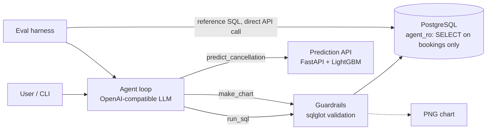
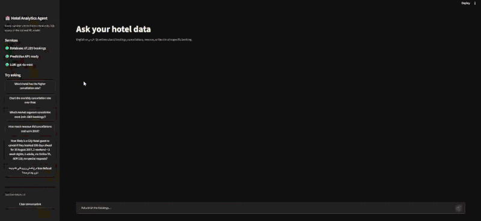
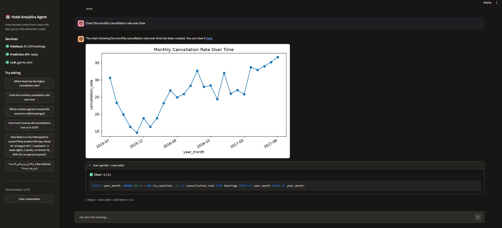
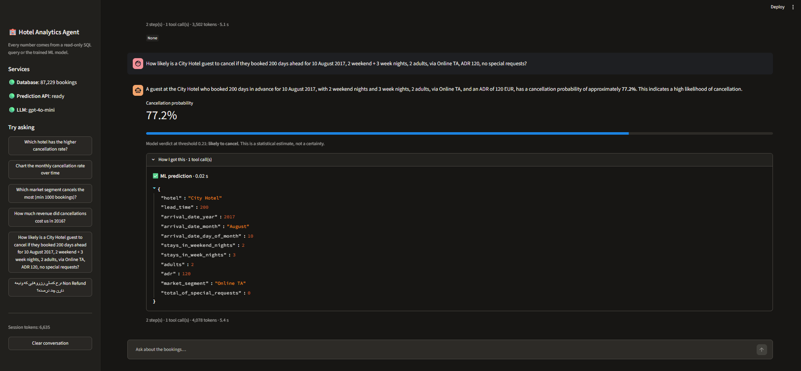

# Hotel Analytics Agent

An LLM agent that answers business questions about hotel bookings in plain language (English or
Persian). It writes **guarded, read-only SQL** against PostgreSQL, calls a **trained ML model** to
estimate the cancellation risk of a specific booking, and draws charts. It ships with an
**evaluation harness** that measures how often the agent is actually right.

Built on top of [Hotel-Booking-Demand](https://github.com/Jahan-Jahan/Hotel-Booking-Demand)
(the PostgreSQL analysis layer and the cancellation-prediction API).

## Architecture



The agent loop is written directly on the OpenAI SDK (no framework): send messages + tool schemas,
execute the tool calls the model asks for, send the results back, repeat until a final answer.
The LLM endpoint is just `LLM_BASE_URL` + `LLM_API_KEY` + `LLM_MODEL`, so GapGPT, Groq, OpenRouter,
Ollama or OpenAI can be swapped without code changes.

## Safety: the LLM is never trusted

LLM-written SQL is the main risk, so protection is layered. Each layer still holds if the one
before it is fooled:

| Layer | What it does | Tested by |
|---|---|---|
| 1. Validation (`guardrails.py`) | Parses the query: one statement, `SELECT` only, only the `bookings` view, no `SELECT INTO`, locks, schema-qualified names, table functions or `pg_*` functions | parametrised unit tests (allowed and blocked queries) |
| 2. Execution wrapper | Runs the query as `SELECT * FROM (<query>) LIMIT n`, so a stacked `; DROP ...` is a syntax error in Postgres itself | integration test |
| 3. Database role | `agent_ro` can only `SELECT` from `bookings`, in read-only transactions, with a 5 s statement timeout | integration test that bypasses all Python checks |

Other design choices: the agent sees SQL errors and can self-correct (with hints for common Postgres
pitfalls); charts are produced from SQL + column names so numbers never pass through the LLM;
tool results are declared as data, not instructions; row, step and timeout limits bound cost.

## Quick start

**Prerequisites:** the Hotel-Booking-Demand project running (PostgreSQL with the `bookings` view and
the prediction API) and an API key for an OpenAI-compatible LLM.

```bash
# 1. In Hotel-Booking-Demand
make db-up && make sql && make train
make serve                      # prediction API on :8000  (keep it running)

# 2. In this repo
pip install -r requirements-dev.txt
cp .env.example .env            # Windows: copy .env.example .env  -> then edit the values
make db-role                    # creates the read-only DB user (re-run after every `make sql`)

# 3. Use it
make chat                                     # interactive, shows tool calls
make ask Q="Which hotel has the higher cancellation rate?"
make test                                     # unit + integration tests
make eval                                     # evaluation on the 23-question set
```

### Demo UI

```bash
make ui          # or: streamlit run app.py   ->  http://localhost:8501
```

A chat interface with live service status, example questions, and a **"How I got this"** panel under every
answer that shows the exact SQL, the result table and the model inputs, so each number can be verified.
Persian answers render right-to-left.

Example questions: *"Which market segment cancels the most?"*, *"Chart the monthly cancellation rate"*,
*"How likely is a City Hotel guest to cancel if they booked 200 days ahead for August 10, 2017,
2 weekend + 3 week nights, 2 adults, ADR 120?"*

<p align="center">
  
</p>

| Chart | Risk prediction |
|---|---|
|  |  |

### Docker

The UI also runs in a container (non-root, health-checked, no secrets baked into the image). PostgreSQL and
the prediction API stay in Hotel-Booking-Demand; start them first.

```bash
cp .env.example .env     # set LLM_API_KEY (and base URL / model)
make docker-up           # builds the image and starts the UI -> http://localhost:8501
make docker-down
```

Inside a container `localhost` is the container itself, so `docker-compose.yml` reaches the host's published
ports through `host.docker.internal` (Postgres on 5433, the API on 8000). Override with `DOCKER_DATABASE_URL`,
`DOCKER_PREDICT_API_URL` and `DOCKER_ADMIN_DATABASE_URL` in `.env` if yours differ. Run one-off commands in the
same environment with `docker compose run --rm ui python -m hotel_agent.setup_db`. CI builds the image and
smoke-tests it on every push. Verified end to end on Windows with Docker Desktop: the image builds, the
container reports healthy and all service indicators in the UI are green.

## Evaluation

`evals/questions.yaml` holds 23 cases. Nothing is hard-coded: reference answers are computed from the
database at run time.

| Category | Cases | How it is scored |
|---|---|---|
| `sql` | 16 | Some executed query must match the reference result (order and extra columns ignored, numeric tolerance), **and** the answer text must state the value |
| `predict` | 3 | The agent's call to the ML model must give the same probability as a direct API call with the correct inputs (catches wrongly extracted fields; includes a Persian case) |
| `chart` | 1 | A chart with enough points must be created |
| `refusal` | 3 | Out-of-scope, destructive and prompt-injection requests: no successful tool call |

It also reports steps, tool calls, latency, tokens, SQL errors and guardrail blocks per run
(`evals/results/*.json`, summary in `evals/results/latest.md`).

**The harness itself is tested:** a scripted "perfect agent" must score 100% and a deliberately wrong
one must fail (`tests/test_integration.py`), so a low score means the model is wrong, not the scorer.

### Results

All runs: `gpt-4o-mini` through an OpenAI-compatible endpoint (GapGPT), temperature 0.

**Run 1: full evaluation (2026-11-26)**

| Category | Passed | Rate |
|---|---|---|
| sql | 16/16 | 100% |
| chart | 1/1 | 100% |
| predict | 1/3 | 33% |
| refusal | 3/3 | 100% |
| **Overall** | **21/23** | **91%** |

1.91 steps and 0.96 tool calls per question on average, 4.3 s latency, about 2.9k tokens per question, no SQL
errors and no guardrail blocks.

**Run 2: `predict` category only, after fixing the tool (2026-11-27)**

| Case | Run 1 | After better error messages | After tool description + automatic retry |
|---|---|---|---|
| `p01_risky_booking` | fail | pass | pass |
| `p02_loyal_guest_persian` | fail | pass | pass |
| `p03_group_non_refund` | pass | fail | pass |
| **Passed** | **1/3** | **2/3** | **3/3** |

Only the `predict` category was re-run after these changes (3/3, 3.0 steps and 6.6 s on average); the other
categories were last measured in Run 1.

**Failure analysis.** The failures were all in `predict`, and all were the same kind: the model forgot to pass a field
that was in the question (weekend nights, the hotel name) and then asked the user for it instead of retrying, because the
tool error said to "ask the user". In `p03` the trace also showed that the model had silently dropped an *optional* field
(`previous_cancellations`). That is the dangerous case: the call would have succeeded with a wrong probability. The eval
catches it because it compares the agent's probability with a direct API call that uses the correct inputs. Fixes:
the tool now names invalid fields and tells the model to retry; the tool description says to map every detail the user
gives; and the agent loop re-prompts the model once per question when it gives up right after a fixable argument error.
Two of the three cases needed more than the minimum 2 steps, which suggests the retry path was used (the number of
automatic retries is not logged yet).

**How to read these numbers.** The question set was used while developing the prompt and the tools (the prompt was
changed after the first run failed 4 SQL cases: percentages computed on 0-1 fractions, a wrong answer language and one
scorer bug), so these are *development-set* scores, not unbiased estimates. Model output also varies between runs even at
temperature 0 (`p03` passed in Run 1 and failed in the next run, with no change that should affect it), so repeat a
run before relying on a single number. A held-out set of unseen questions is the next step.

## Project structure

```
hotel_agent/
  config.py        settings from environment / .env
  agent.py         the agent loop (tool calling, history, token + latency accounting)
  prompts.py       system prompt and data dictionary
  guardrails.py    SQL validation
  setup_db.py      creates the read-only role (db/readonly_role.sql)
  tools/           run_sql, predict_cancellation, make_chart + tool schemas
  evaluation.py    evaluation harness
  cli.py           command-line chat
  ui_helpers.py    UI logic without Streamlit (service status, tool-call display data)
app.py                  Streamlit demo UI
evals/questions.yaml    evaluation set
tests/                  unit, SDK round-trip (real openai client vs a local mock server), UI (AppTest), integration
db/readonly_role.sql    read-only database role used by the agent
Dockerfile              container image for the Streamlit UI
docker-compose.yml      runs the UI container (database and API come from Hotel-Booking-Demand)
requirements.txt        runtime dependencies (requirements-dev.txt adds pytest)
.github/workflows/ci.yml  unit tests + Docker build and smoke test
```

## Troubleshooting

| Symptom | Cause / fix |
|---|---|
| `Cannot start the evaluation: ... Database check failed` | Run `make db-role` (and make sure Docker/PostgreSQL is up). Re-run it after every `make sql` in Hotel-Booking-Demand |
| `Prediction API ... HTTP 503` or `unreachable` | Start the API (`make serve` in Hotel-Booking-Demand). A system proxy/VPN can answer 503 for localhost; the client already ignores `HTTP(S)_PROXY` for the prediction API |
| A failing eval case | The run prints the agent's SQL, the reference rows and the answer; full details are in `evals/results/<timestamp>_<model>.json` (saved after every case) |
| Answers in the wrong language / wrong rates | Re-run the failing cases after editing `prompts.py`: `python -m hotel_agent.evaluation --ids s02_worst_hotel,s05_busiest_month` |

## Troubleshooting (Docker)

| Symptom | Cause / fix |
|---|---|
| The UI shows 🔴 **Prediction API** | The API on the host must accept connections from containers: start it with `uvicorn src.app:app --host 0.0.0.0 --port 8000`, or run the Hotel-Booking-Demand compose file so it is published by Docker |
| 🔴 **Database** | Run `make db-role` (host) after every `make sql`, and check the published Postgres port (5433 by default) matches `DOCKER_DATABASE_URL` |
| LLM calls time out only in the container | Containers do not inherit your system proxy. If you need one to reach the LLM provider, add `HTTPS_PROXY=...` and `NO_PROXY=host.docker.internal` to `.env` |

## Limitations

- **Execution-match is an approximation.** It can reject an equivalent answer with a different
  shape or accept a lucky match. Wording-sensitive questions state the format they want (e.g. "percentage,
  1 decimal"). The `values` comparison mode relaxes the shape check where needed.
- **Small eval set** (23 cases, one dataset): good for catching regressions, not for statistical claims
  about a model. Rerun it when changing the model or prompt.
- **The prediction tool inherits the model's limits** (see Hotel-Booking-Demand: it uses a few
  features that are usually known only after booking, and was trained on 2015-2017 data).
- **The LLM is a third-party service** reached through an OpenAI-compatible endpoint; the dataset is public,
  but do not point this at private data without reviewing the provider's terms.
- Single-user demo (CLI and Streamlit); no authentication or rate limiting.

## Possible next steps

A held-out eval set, a second model for comparison in the eval, query result caching,
LLM-as-judge for free-text answers, tracing (e.g. OpenTelemetry), logging the number of automatic retries per case,
and one compose file that also starts PostgreSQL and the prediction API.